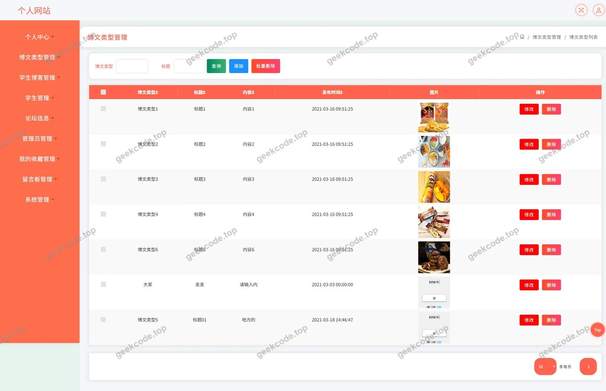
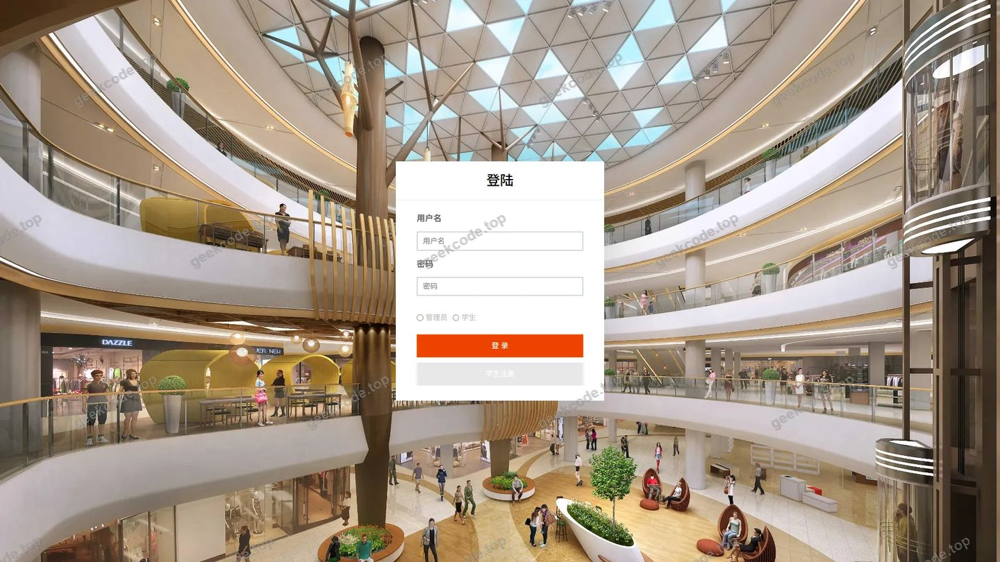
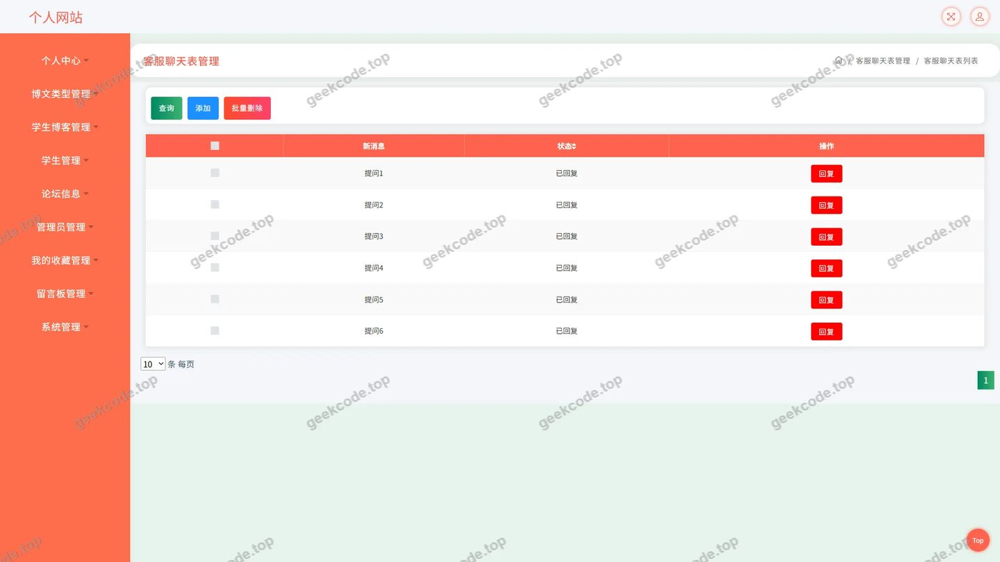
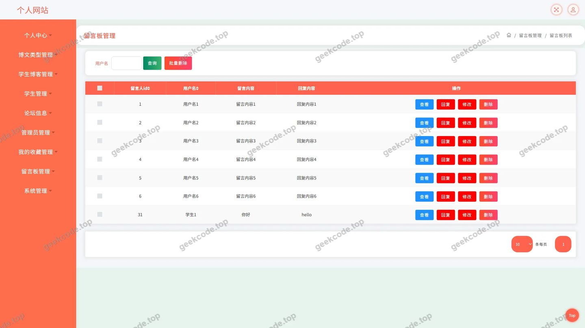
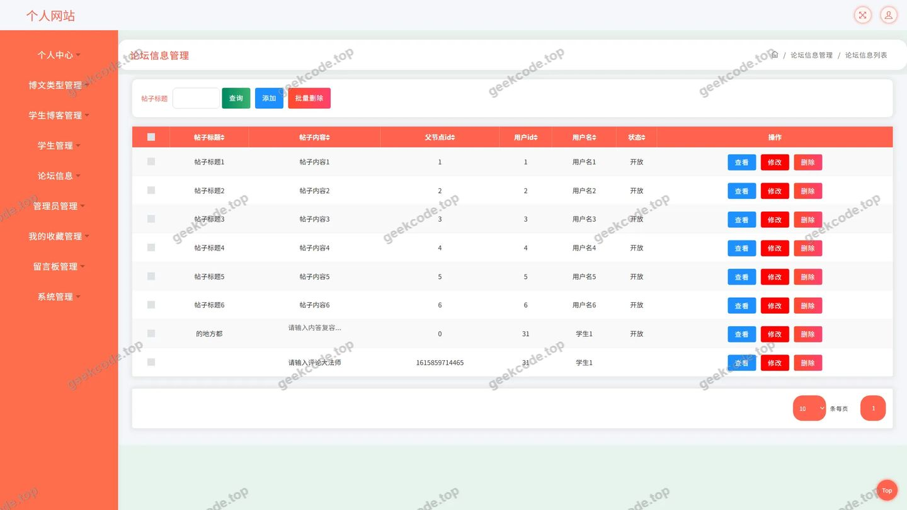
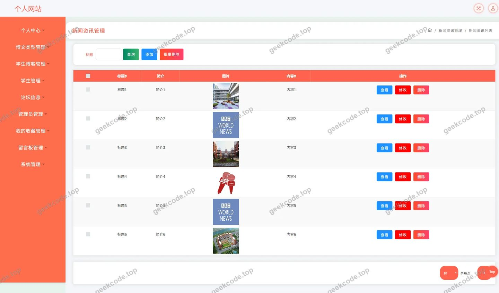
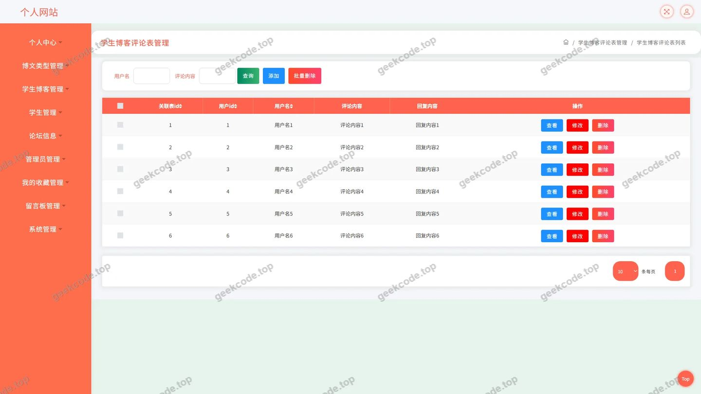
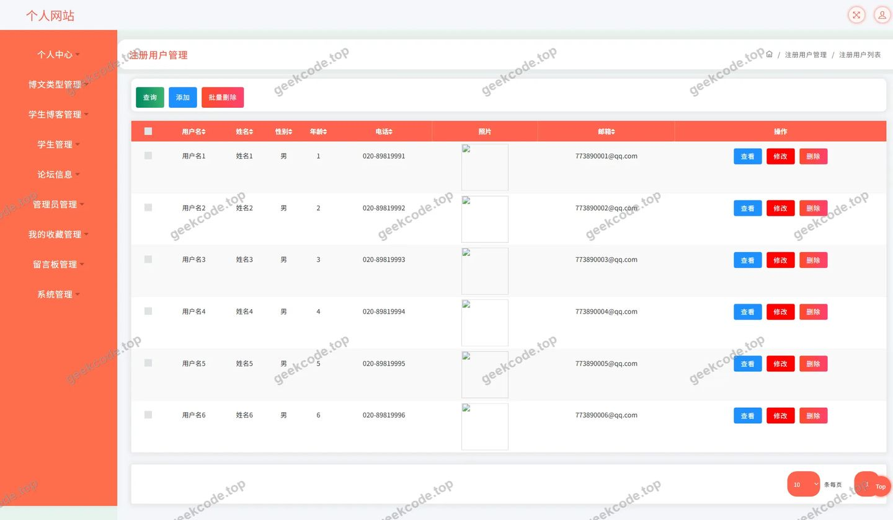

# 多用户博客个人网站

> 🎓 **计算机毕业设计 · 多用户博客个人网站**
>
> 本仓库只放**项目介绍 + 运行截图**（截图是站点带水印的原图，存在仓库 `images/` 里）。
>
> 👉 **完整可运行源码 / 数据库脚本 / 部署文档：[点我获取](https://geekcode.top/archives/%E5%A4%9A%E7%94%A8%E6%88%B7%E5%8D%9A%E5%AE%A2%E4%B8%AA%E4%BA%BA%E7%BD%91%E7%AB%99?utm_source=github)**
>
> 💬 咨询微信：**ir9372**　|　🌐 更多项目：[极客代码 geekcode.top](https://geekcode.top/?utm_source=github)
>
> 📌 项目详情页：<https://geekcode.top/archives/%E5%A4%9A%E7%94%A8%E6%88%B7%E5%8D%9A%E5%AE%A2%E4%B8%AA%E4%BA%BA%E7%BD%91%E7%AB%99?utm_source=github>

<table><td width="230" align="center"> <b>扫码加微信 ir9372</b></td><td valign="middle">📦 源码 = 项目介绍 + 全部运行截图 + 数据库 + 部署文档 👉 点上方任意截图，直接跳到 <b>极客代码 geekcode.top</b> 详情页</td></table>

---

<h1>多用户博客个人网站</h1>
<h2>项目概述</h2>

本项目名为“多用户博客个人网站”，旨在构建一个基于 Web 的多用户内容发布与交流平台。系统核心功能涵盖博文类型管理、学生博客展示、论坛信息交互、新闻资讯浏览以及留言反馈机制。通过集成在线客服（Chat）与评论系统，实现了用户间的高效互动。该项目主要面向高校学生及博客爱好者，提供一个集个人展示、知识分享与社区交流于一体的数字化空间。技术架构上采用纯后端 API 服务模式，专注于业务逻辑处理与数据持久化，为前端应用提供稳定、高效的数据支撑接口。

<h2>技术架构</h2>

本项目采用分层架构设计，以 Spring Boot 为核心框架，结合 MyBatis-Plus 进行数据持久层开发，使用 Druid 作为数据库连接池以优化性能。

<strong>1. 后端架构</strong>
系统后端由多个 Controller 模块组成，分别对应不同的业务领域：

<ul>
<li><strong>内容管理</strong>：<code>BowenleixingController</code> 负责博文类型的分类与维护；<code>NewsController</code> 处理新闻资讯的展示与检索。</li>
<li><strong>用户交互</strong>：<code>DiscussbowenleixingController</code> 和 <code>DiscussxueshengbokeController</code> 分别处理博文类型和学生博客的评论业务；<code>ForumController</code> 管理论坛帖子；<code>MessagesController</code> 处理留言板功能。</li>
<li><strong>基础服务</strong>：<code>FileController</code> 提供文件上传下载服务；<code>CommonController</code> 封装通用工具类接口；<code>ConfigController</code> 管理系统配置参数；<code>DefaultuserController</code> 处理默认用户相关逻辑；<code>StoreupController</code> 实现收藏功能。</li>
<li><strong>即时通讯</strong>：<code>ChatController</code> 支持在线客服或实时聊天功能。</li>
</ul>

<strong>2. 数据访问层</strong>
利用 MyBatis-Plus 简化 CRUD 操作，通过注解驱动的方式映射实体类与数据库表。Druid 连接池监控 SQL 执行效率，确保在高并发场景下的数据读取稳定性。

<strong>3. 核心技术选型理由</strong>

<ul>
<li><strong>Spring Boot</strong>：提供快速启动能力，自动配置减少样板代码，适合微服务或单体应用的快速迭代。</li>
<li><strong>MyBatis-Plus</strong>：在保留 MyBatis 灵活性的基础上，增强了单表 CRUD 效率，适合业务逻辑复杂的查询需求。</li>
<li><strong>Druid</strong>：阿里开源的高性能 JDBC 组件，具备强大的监控和扩展功能，保障数据库连接的安全性与稳定性。</li>
</ul>
<h2>功能模块</h2>

根据源码中的 Controller 列表及截图所示功能，系统主要包含以下模块：

<h3>前台用户端功能</h3>

虽然项目类型为 pure-api 且无独立的前台路由配置，但通过 API 接口支持以下业务场景：

<ol>
<li><strong>用户认证与管理</strong></li>
</ol>
<ul>
<li><strong>注册与登录</strong>：支持新用户注册及现有用户身份验证（对应截图“页面-登录”、“页面-注册用户”）。</li>
<li><strong>个人中心</strong>：查看个人信息、管理我的发布内容及我的收藏记录。</li>
</ul>
<ol start="2">
<li><strong>内容浏览与发布</strong></li>
</ol>
<ul>
<li><strong>博文类型</strong>：浏览不同分类的博文集合（对应截图“页面-博文类型”）。</li>
<li><strong>学生博客</strong>：查看学生发布的个人博客文章（对应截图“页面-学生博客评论”中的主体内容）。</li>
<li><strong>新闻资讯</strong>：获取平台发布的新闻列表及详情（对应截图“页面-新闻资讯”）。</li>
<li><strong>论坛信息</strong>：浏览论坛帖子列表及具体内容（对应截图“页面-论坛信息”）。</li>
</ul>
<ol start="3">
<li><strong>互动与反馈</strong></li>
</ol>
<ul>
<li><strong>评论系统</strong>：对博文类型和学生博客发表评论内容（对应截图“页面-博文类型评论”、“页面-学生博客评论”）。</li>
<li><strong>留言反馈</strong>：通过留言板提交意见或建议（对应截图“页面-留言板”）。</li>
<li><strong>在线客服</strong>：通过聊天窗口与客服人员进行实时沟通（对应截图“页面-客服”）。</li>
</ul>
<ol start="4">
<li><strong>资源管理</strong></li>
</ol>
<ul>
<li><strong>文件服务</strong>：支持头像、附件等文件的上传与存储。</li>
<li><strong>收藏功能</strong>：用户可对感兴趣的文章或资讯进行收藏。</li>
</ul>
<h3>后台管理端功能</h3>

<strong>注意</strong>：根据提供的上下文信息，该项目明确标注“是否有后台: 否”且“(无后台路由)”。因此，本部分仅描述通过 API 可能隐含的管理能力，或者说明当前版本未包含独立的后台管理界面模块。若需完整的管理员权限体系（如审核评论、管理用户封禁等），需额外开发管理端接口或界面，目前源码列表中未体现专门的 AdminController 或后台路由定义。

<h2>用户角色与权限</h2>

基于 Controller 命名及常见博客系统设计，推测并定义以下角色权限模型：

<ol>
<li><strong>普通用户 (Registered User)</strong></li>
</ol>
<ul>
<li><strong>权限范围</strong>：</li>
<li><strong>浏览</strong>：查看所有公开的博文类型、学生博客、新闻资讯、论坛信息及留言。</li>
<li><strong>互动</strong>：发表评论（针对博文类型和学生博客）、参与论坛发帖、使用在线客服、提交留言反馈。</li>
<li><strong>个人管理</strong>：编辑个人资料、管理自己发布的博文/博客、查看和管理自己的收藏列表。</li>
<li><strong>限制</strong>：无法删除他人内容，无法访问系统配置接口。</li>
</ul>
<ol start="2">
<li><strong>游客 (Guest)</strong></li>
</ol>
<ul>
<li><strong>权限范围</strong>：</li>
<li><strong>浏览</strong>：仅能查看公开的博文类型、新闻资讯、论坛信息等只读内容。</li>
<li><strong>限制</strong>：无法进行评论、收藏、发帖或使用客服功能，需登录后方可执行写操作。</li>
</ul>
<ol start="3">
<li><strong>管理员 (Administrator)</strong></li>
</ol>
<ul>
<li><strong>现状说明</strong>：根据现有信息无法确定具体的管理员后台功能模块，因为项目标记为无后台路由。但在实际部署中，通常拥有最高权限，包括：</li>
<li><strong>内容审核</strong>：删除违规评论、帖子或博文。</li>
<li><strong>用户管理</strong>：禁用或启用用户账号。</li>
<li><strong>系统配置</strong>：修改全局参数（通过 <code>ConfigController</code> 潜在支持）。</li>
<li><em>注：由于缺乏明确的 Admin Controller 和后台界面，上述管理员权限仅为基于系统完整性的理论推断，具体实现需参考后续补充的开发文档。</em></li>
</ul>
<h2>项目特色与创新点</h2>
<ol>
<li>
<strong>多维度的内容聚合</strong>
   项目不仅限于传统的博客功能，还融合了“论坛信息”与“新闻资讯”，形成了从个人表达（博客）、公共讨论（论坛）到官方发布（新闻）的全方位内容生态，满足了不同层次用户的阅读与交流需求。

</li>
<li>
<strong>细粒度的互动体系</strong>
   设计了独立的评论控制器（<code>Discuss...Controller</code>），将评论逻辑与主内容逻辑解耦，提高了系统的可维护性。同时引入“在线客服”（<code>ChatController</code>）功能，打破了传统博客单向传播的限制，增强了用户与平台之间的实时连接。

</li>
<li>
<strong>标准化的 API 架构</strong>
   采用 Pure-API 模式，前后端彻底分离。这种架构使得系统易于扩展至移动端 App、微信小程序或其他第三方客户端，仅需复用同一套后端接口即可适配多种终端，降低了多端开发的成本。

</li>
<li>
<strong>完善的资源管理体系</strong>
   集成了文件上传（<code>FileController</code>）、收藏（<code>StoreupController</code>）及个人中心管理，构建了闭环的用户数据生命周期管理，提升了用户体验的连贯性。

</li>
</ol>
<h2>部署环境</h2>

为确保项目正常运行，服务器环境需满足以下要求：

<ol>
<li><strong>操作系统</strong></li>
</ol>
<ul>
<li>Linux (CentOS 7+, Ubuntu 18.04+) 或 Windows Server 2016+。</li>
</ul>
<ol start="2">
<li><strong>Java 运行环境</strong></li>
</ol>
<ul>
<li>JDK 1.8 或更高版本（推荐 JDK 1.8 LTS，因依赖中包含 spring-core, spring-context 等标准 Spring 5.x 系列组件）。</li>
</ul>
<ol start="3">
<li><strong>数据库</strong></li>
</ol>
<ul>
<li>MySQL 5.7 或 MySQL 8.0。</li>
<li>需预先创建数据库实例，并导入相应的表结构脚本（MyBatis-Plus 依赖底层数据库表存在）。</li>
</ul>
<ol start="4">
<li><strong>构建工具</strong></li>
</ol>
<ul>
<li>Maven 3.6+ 或 Gradle（用于编译打包 Java 源代码及解析依赖）。</li>
</ul>
<ol start="5">
<li><strong>Web 容器</strong></li>
</ol>
<ul>
<li>内置 Tomcat（Spring Boot 默认集成），无需单独安装外部 Tomcat，直接运行 jar 包即可。</li>
</ul>
<ol start="6">
<li><strong>其他依赖</strong></li>
</ol>
<ul>
<li>Node.js：虽然项目为 pure-api，但若前端页面需要静态资源编译或本地调试，可能需要 Node.js 环境（根据截图显示有页面渲染，通常前端会单独部署或嵌入静态资源，此处假设前端已独立部署或仅测试 API）。</li>
<li>Nginx：建议配合 Nginx 作为反向代理服务器，处理静态资源缓存及负载均衡。</li>
</ul>
<h2>五、技术特性</h2>
<ul>
<li>使用 MyBatis-Plus 简化数据访问层开发</li>
</ul>
<h2>六、功能模块截图</h2>
<h3>后台管理端</h3>
<h4>页面-博文类型</h4>

<h4>页面-博文类型评论</h4>

<h4>页面-登录</h4>

<h4>页面-客服</h4>

<h4>页面-留言板</h4>

<h4>页面-论坛信息</h4>

<h4>页面-新闻资讯</h4>

<h4>页面-学生博客评论</h4>

<h4>页面-注册用户</h4>

---

## 获取完整源码

| 项目 | 说明 |
| --- | --- |
| 项目名 | 多用户博客个人网站 |
| 运行截图 | 本文 9 张（站点带水印原图，仓库 `images/` 目录） |
| 完整源码 | [https://geekcode.top/archives/%E5%A4%9A%E7%94%A8%E6%88%B7%E5%8D%9A%E5%AE%A2%E4%B8%AA%E4%BA%BA%E7%BD%91%E7%AB%99?utm_source=github](https://geekcode.top/archives/%E5%A4%9A%E7%94%A8%E6%88%B7%E5%8D%9A%E5%AE%A2%E4%B8%AA%E4%BA%BA%E7%BD%91%E7%AB%99?utm_source=github) |
| 咨询微信 | **ir9372**（备注：jingpin-yuanma） |
| 更多项目 | [极客代码 geekcode.top](https://geekcode.top/?utm_source=github) |

> 需要源码、部署、改配置、跑不起来等问题，加微信 ir9372 沟通，说明项目名即可。
